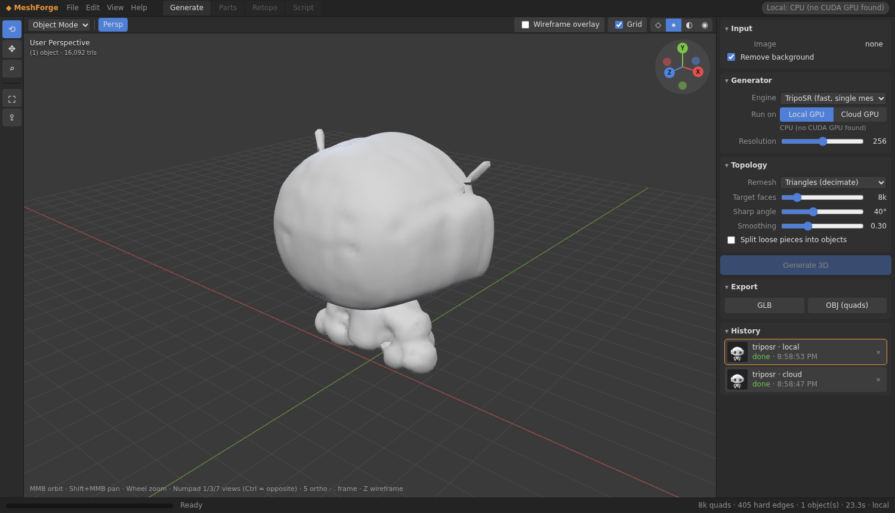
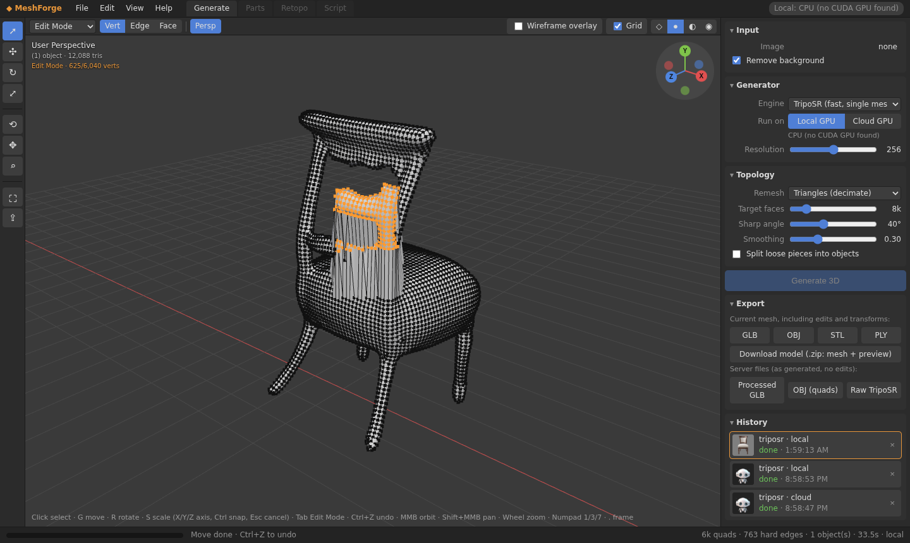
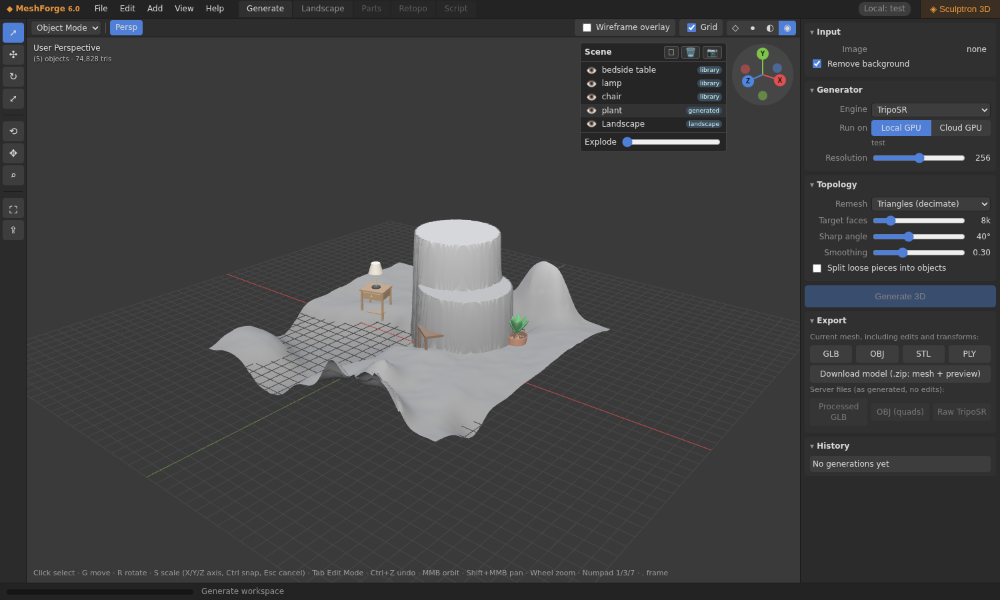
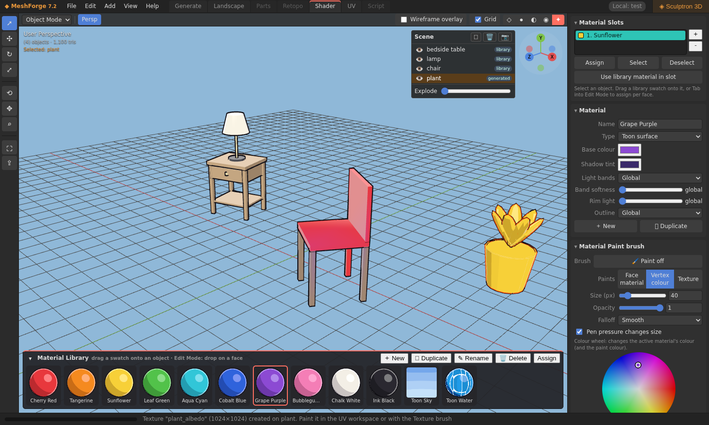

# MeshForge

Local, free, open-source image-to-3D with a Blender-style browser editor.

Drop a photo in, get a mesh on your own GPU, then move, sculpt, paint and lay out a level without sending the picture anywhere.



## What you can do

- Generate a mesh from one image with TripoSR (MIT), locally or through the optional cloud adapter
- Edit vertices, edges and faces, and sculpt with the built-in brushes
- Paint a landscape (terrain, water, several building types, trees) and send it into the level as a hierarchy
- Shade with the Chibili toon look, assign materials, unwrap UVs and paint textures
- Import GLB, glTF and OBJ+MTL with UVs, textures and materials kept
- Preview a rigged GLB (skeleton, clips, pose). Pose Mode tells you when a mesh has no rig
- Save a `.mfproj` project, autosave on a timer, and recover the newest copy
- Group, hide, join and select similar objects from the outliner
- Add a trusted local plugin. The AI Agent plugin can connect to Claude, ChatGPT, Grok, or a local OpenAI-compatible model. Keys stay in the browser tab and are checked once, not saved





A short screen recording of the v8 undo and outliner flow can replace the stills above. The pictures already in `meshforge-proto/docs/img/` are the current stand-ins.

## Quick start

### Windows

An RTX 4060 8 GB has been used for this build. Close other GPU apps if a generation runs out of memory, and lower the mesh grid.

1. Install Python 3.11 and the NVIDIA driver. `nvidia-smi` should see the card.
2. Double-click `meshforge-proto/setup_windows.bat` once.
3. Double-click `meshforge-proto/run_windows.bat`.
4. Open http://127.0.0.1:8000

If port 8000 is busy:

```bat
cd /d "C:\path\to\meshforge-proto" && set MESHFORGE_PORT=8001 && run_windows.bat
```

More detail is in [meshforge-proto/WINDOWS.md](meshforge-proto/WINDOWS.md).

### Linux

```bash
cd meshforge-proto
python3 -m venv .venv && . .venv/bin/activate
pip install -r requirements.txt
# GPU: install the CUDA PyTorch wheel that matches your driver, then the rest of requirements.txt
python -m meshforge.server
```

Open http://127.0.0.1:8000 . Without an NVIDIA GPU the server can still boot; a generation then runs on CPU and is much slower.

## System requirements

| | |
|---|---|
| OS | Windows 10/11 or a current Linux |
| GPU | NVIDIA, 8 GB has been used (RTX 4060). CPU works for the editor and is slow for generation |
| Disk | About 2 GB for the TripoSR weights on first use, plus the Python environment |
| Browser | A current Chrome, Edge or Firefox. The editor is one page of plain JavaScript |
| Network | First TripoSR run downloads weights. After that the app is usable offline. Plugins you install are local code |

The input image is kept up to 1024 px on the long side. The mesh grid defaults to 256 and stops at 384 so the 8 GB card is not asked for a 1024³ marching-cubes grid.

## Roadmap

- Keep generation from wiping a level you already built (this release)
- PartCrafter-class part generation that fits 8 GB, still MIT
- Clearer topology than marching cubes, without a new proprietary model in this release
- Rig preview stays import-only. MeshForge does not auto-rig

Not in this release: an AI agent inside the editor, a new foundation model, or automatic rigging.

## Plugins

Plugins are trusted local JavaScript and Python. There is no sandbox. The host API is `mf.registerTab`, `mf.jobs`, and `mf.secrets` (session-only). Read [meshforge-proto/docs/plugins.md](meshforge-proto/docs/plugins.md). The example plugin is `meshforge-proto/plugins/_example/`.

A plugin that asks for an API key holds it in memory for the tab. MeshForge does not check the key with a provider. Scene From Photo, which is not in this repository, does not call a model yet, so entering a key does not sign you in.

## Contributing

See [CONTRIBUTING.md](CONTRIBUTING.md) and [CODE_OF_CONDUCT.md](CODE_OF_CONDUCT.md). Security reports go through [SECURITY.md](SECURITY.md). Please do not open a pull request that contains API keys, tokens or login dumps.

## Licence and credits

MeshForge is [MIT](LICENSE-MIT.txt). TripoSR (Stability AI, MIT) is the image-to-3D engine. three.js and its loaders in `frontend/vendor/` are MIT. Do not copy GPL editor source, names or logos into this tree.

## Suggested GitHub topics

`image-to-3d` `3d` `triposr` `threejs` `fastapi` `local-first` `open-source` `mit-license` `mesh-generation` `browser-editor`
