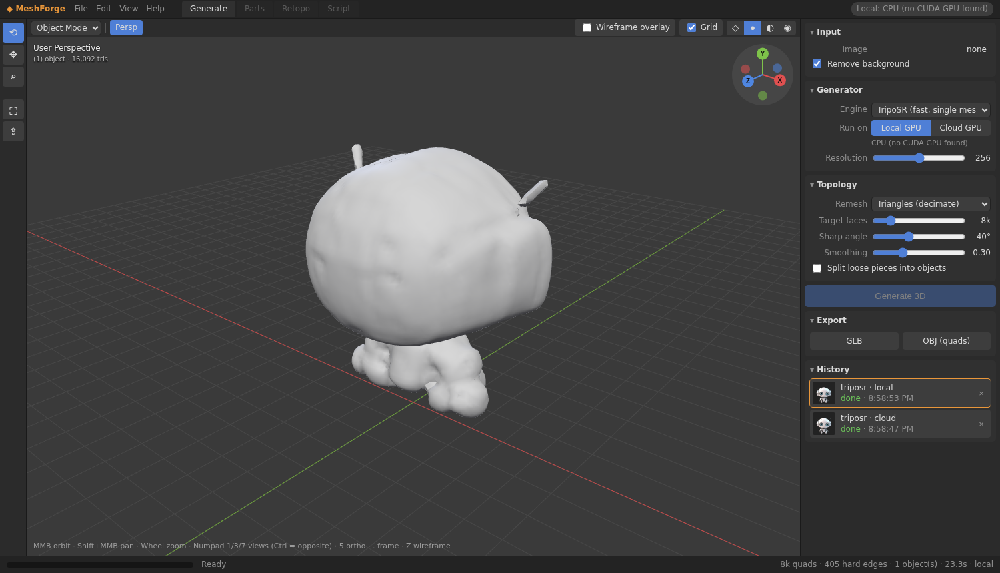
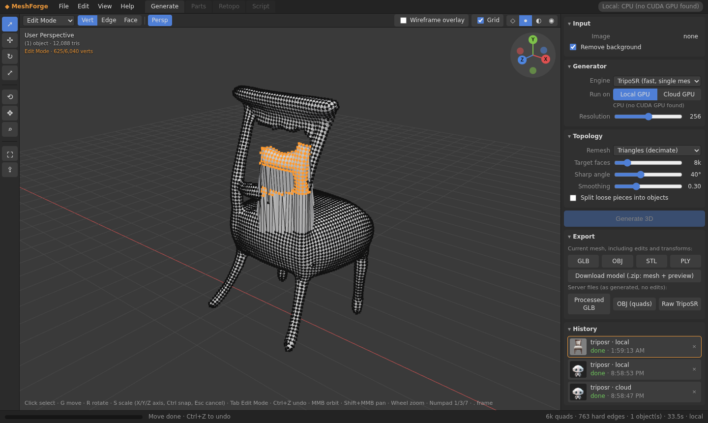

# MeshForge prototype - image → 3D, local GPU or cloud GPU

Drop an image, pick an engine and **Run on: Local GPU / Cloud GPU**, get a cleaned, low-poly (optionally quad) mesh as GLB/OBJ in a DCC-style 3D viewport.
Engine now: **TripoSR** (MIT). Planned: PartCrafter (next, fits 8 GB), OmniPart, TRELLIS.2 (cloud).



Docs: [requirements & cloud research](docs/requirements.md) · [architecture](docs/architecture.md) · [post-processing benchmark](docs/postprocessing.md) · [licensing](docs/licensing.md)

## Windows (RTX 4060) - native, recommended
**See [WINDOWS.md](WINDOWS.md).** No Ubuntu/WSL: double-click `setup_windows.bat` once, then `run_windows.bat`
(opens http://127.0.0.1:8000). `diagnose_windows.bat` writes `diagnose.txt` for troubleshooting.

<details><summary>Alternative: WSL2 (advanced)</summary>

In **PowerShell (admin)**: `wsl --install -d Ubuntu-22.04`, reboot, open Ubuntu. Keep the normal NVIDIA Windows driver; don't install a Linux driver in WSL.
```bash
sudo apt update && sudo apt install -y python3.11 python3.11-venv git build-essential
nvidia-smi                                  # must show the RTX 4060
git clone <your repo url> meshforge-proto && cd meshforge-proto   # or copy this folder in
PYTHON=python3.11 ./run.sh --setup          # first time: venv, CUDA torch, TripoSR, deps
./run.sh                                     # every other time
```
Open **http://127.0.0.1:8000** in your Windows browser. Stop with Ctrl+C.
</details>

## Linux
```bash
sudo apt install -y python3.11 python3.11-venv git build-essential
PYTHON=python3.11 ./run.sh --setup && ./run.sh
```
No NVIDIA GPU? `run.sh` installs CPU wheels; a generation then takes ~25–45 s and ~3 GB RAM.

## Cloud GPU (optional - costs money)
- `MESHFORGE_CLOUD=mock ./run.sh` (default): demo adapter, free, returns a sample 3-part mesh.
- **Modal (coded, UNTESTED):** `pip install modal && modal token new && modal deploy cloud/modal_app.py`, then `MESHFORGE_CLOUD=modal ./run.sh`. Credentials only via `modal token new` or `MODAL_TOKEN_ID`/`MODAL_TOKEN_SECRET`; nothing is stored by MeshForge.
- **Your own GPU box:** run MeshForge there, then locally `ssh -L 9000:127.0.0.1:8000 user@gpu-host` and `MESHFORGE_CLOUD=remote MESHFORGE_REMOTE_URL=http://127.0.0.1:9000 ./run.sh`. Never expose the port publicly.

## Viewport controls
MMB drag orbit · Shift+MMB pan · wheel zoom · left button selects (or orbits/pans/zooms with those shelf tools) · Numpad 1/3/7 front/right/top (Ctrl = opposite; 1/3/7 on the top row also work) · 5 persp/ortho · `.` or Home frame · Z toggle wireframe · click gizmo axes to snap. Shading: wireframe / solid / matcap / vertex colour, wireframe overlay, grid.

## Editing and exporting (new in v3)



**Tools (left shelf):** Select, Move, Rotate, Scale, then Orbit / Pan / Zoom. Click the model to select it (orange outline). With Move, Rotate or Scale active, a gizmo appears on the selection. Drag an arrow, ring or handle to transform; orbiting is paused while you drag.

**Edit Mode:** pick it in the mode dropdown (or press Tab). The mesh shows its vertices, edges and faces. If you generated with *Quads (Instant Meshes)*, the quad edges are shown; otherwise the triangle edges are. Use the Vert / Edge / Face buttons (or 1 / 2 / 3), click to select (Shift adds or toggles), and drag with the Select tool to box-select the visible elements. G / R / S then move, rotate or scale the selection. The surface updates live and its normals are recalculated. Edit Mode is designed for meshes up to about 10k faces and is capped at 200k triangles.

| Key | What it does |
|---|---|
| Left click | Select object / vertex / edge / face (Shift = add or toggle) |
| Left drag (Select tool, Edit Mode) | Box select (visible elements only) |
| G / R / S | Move / Rotate / Scale with the mouse; click or Enter to confirm |
| X / Y / Z while moving | Lock to that world axis (press again to unlock) |
| Hold Ctrl while moving | Snap (0.1 units, 15°, 0.1× scale) |
| Esc or right click | Cancel the current move |
| Tab | Object Mode ⇄ Edit Mode |
| 1 / 2 / 3 (Edit Mode) | Vertex / Edge / Face select |
| A / Alt+A | Select all (toggle) / deselect all |
| Ctrl+Z / Ctrl+Shift+Z (or Ctrl+Y) | Undo / Redo (moves and vertex edits) |
| MMB drag / Shift+MMB / wheel | Orbit / Pan / Zoom |
| Numpad 1 / 3 / 7 (Ctrl = opposite), 5, `.` | Front / Right / Top, Persp/Ortho, Frame |
| Z | Toggle wireframe shading |

Help ▸ Keyboard shortcuts shows the same table inside the app.

**Export (Export panel or File menu).** GLB, OBJ, STL and PLY are written in the browser from the *current* mesh, so they include your Edit Mode changes and the object's move, rotate and scale. **Download model (.zip)** bundles `mesh.glb`, `mesh.obj` and a `preview.png` of the viewport. The server copies are also there: the **Processed GLB**, the **OBJ (quads)** (real quads, no edits), and the **Raw TripoSR** mesh before clean-up, so you can compare. The raw mesh is kept for jobs generated with v3 or later. Click any finished item in **History** to reload it, then export it the same way.


## Landscape mode (new in v4)
Click the **Landscape** tab at the top (or View ▸ Landscape workspace). Everything runs in the browser, no GPU job and no new installs.
1. **Paint** on the map with the Brush: yellow = sand (low), green = grass, blue = water (below the water plane), black = mountain (high). Erase paints back to grass. The 3D view updates a moment after each stroke.
2. **Or load an image**: drop a painted picture (colours snap to the nearest of the four) or a black-and-white height map (white = high) onto the map, or use *Load painted…* / *Load height map…*.
3. **Cliffs and hills**: pick Lasso, Rect or Circle and draw on the map. Set *Height* (metres above the ground around it) and *Blend* (0 = sharp cliff, bigger = gentle hill), and tick *Plateau* for a flat top. Regions apply top to bottom, so stack them for terraces; ▲/▼ reorders, the tick box turns one off.
4. **Tune** base heights, noise, edge blend, grid size (64–256) and world size under Terrain; the water level under Water; density, spacing, max slope, cliff clearance and tall-building share under Buildings. *Load house module (.glb)* swaps the default house for your own model.
5. **Randomize map** makes a new map from the seed (same seed = same map). **Export** saves GLB/OBJ/STL/PLY (terrain, plus buildings and water if ticked), the height map PNG, the painted map PNG, or the whole landscape as a .json project you can reopen.

For the future Play button: `MeshForgeLandscape.generate({ seed: 123 })` returns `{ group, terrain, sampleHeight(x, z), buildings, field }`.

## Scenes: many objects at once (new in v6)

Open `http://127.0.0.1:8000/?scene=/scenes/demo/scene.json`, or use *File ▸ Import scene (GLB / manifest)…*. Every object in the scene is separate, and you can select it in the Scene panel or in 3D. Edit Mode, Sculpt Mode and Move/Rotate/Scale work on the selected object only. Delete and Shift+D delete and duplicate it. Format and API: [docs/scene-import.md](docs/scene-import.md).

## Sculpt mode (new in v5)
Pick **Sculpt Mode** in the mode menu (top left of the viewport) with an object selected, or choose **Add ▸ Sphere** to start from a ball (20k, 80k or 320k triangles). Drag on the model to sculpt. Drag off the model, or use the middle mouse button, to orbit. Tab takes you back to Object Mode.

**The ten brushes** (left-hand palette, keys 1–0):
1 Standard (raise along the surface) · 2 Clay (fills dips, one even layer per stroke) · 3 Clay Buildup (square-edged, keeps building up with every pass) · 4 Move (grab and drag) · 5 Smooth · 6 Chisel (cuts high points flat with a hard edge) · 7 Carve (crease / V-groove) · 8 Pen (fine detail line at a third of the brush size) · 9 Inflate · 0 Pinch

**Keys:** Shift held = smooth · Alt held = invert (dig instead of raise) · S + move mouse, or [ ] = brush size · U + move mouse, or Shift+[ ] = strength · X = X symmetry (on by default) · L = lazy mouse · F = cycle falloff (brush default / soft / sharp / constant) · D = Sculptron 3D · H = shortcut panel · Ctrl+Z / Ctrl+Shift+Z = undo / redo a stroke.

Strokes are spaced and interpolated along the mouse path (Spacing slider), use a stable averaged surface normal, and have an optional lazy-mouse rope for clean lines. Symmetry mirrors across the object's own X (and optionally Y/Z) axis.

**Sculptron 3D** (orange button at the top right of the window): turns on adaptive detail. While it is on, triangle edges under the brush that are longer than the detail size are split, so you can keep adding local detail without stretching. *Detail by brush size* keeps detail relative to the brush; *Constant* uses a fixed size. A triangle counter appears next to the button; you get a warning at 500k triangles and detail stops at the hard cap (1,000,000 by default, editable in the panel). It only adds triangles: it doesn't reduce them again (no edge collapse yet).

Sculpting welds the mesh's shared vertices first so seams don't tear (vertex colours and UVs are not kept on a sculpted mesh). Exports (GLB/OBJ/STL/PLY/zip) include your sculpting, also with Sculptron 3D, and Edit Mode works on the sculpted mesh afterwards.

## Using MeshForge from other programs (new in v5.1)
`python -m meshforge.api --image cutout.png --out out/obj1` or `from meshforge.api import generate_mesh` makes one mesh from one image without the browser; `window.MeshForge.loadGLB()` loads a GLB into the page. See docs/integration.md.

## Layout
```
meshforge/  server.py (FastAPI) · jobs.py (queue + history) · preprocess.py · postprocess.py
            engines/ (base.py, triposr.py, registry) · runners/ (local.py, cloud.py: mock/modal/remote)
frontend/   index.html · style.css · app.js · editor.js (selection, Edit Mode, undo, export) · landscape.js + landui.js (Landscape mode) · sculpt.js (Sculpt mode + Sculptron 3D) · vendor/ (three.js 0.170 + addons, MIT)
cloud/      modal_app.py (untested)
tools_compare.py   before/after post-processing benchmark
run.sh             one-command setup/launch (Linux/WSL)
*_windows.bat      Windows setup / run / diagnose (call scripts/*.ps1)
```
API: `POST /api/jobs` (multipart: image, engine, runner, remove_bg, params JSON) · `GET /api/jobs[/{id}]` · `GET /api/jobs/{id}/mesh.glb|mesh.obj|raw.glb|input|processed.png` · `DELETE /api/jobs/{id}` · `GET /api/config`.
Params: `resolution` 128–384, `remesh` decimate|quad|none, `target_faces`, `sharp_angle` (deg), `smooth_strength` 0–1, `split_components`.
