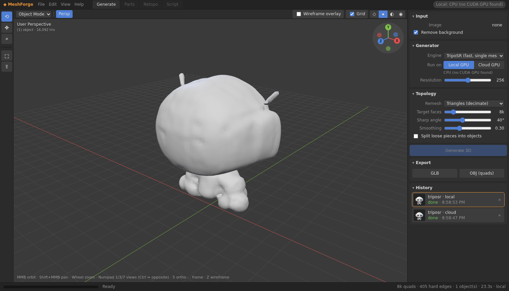
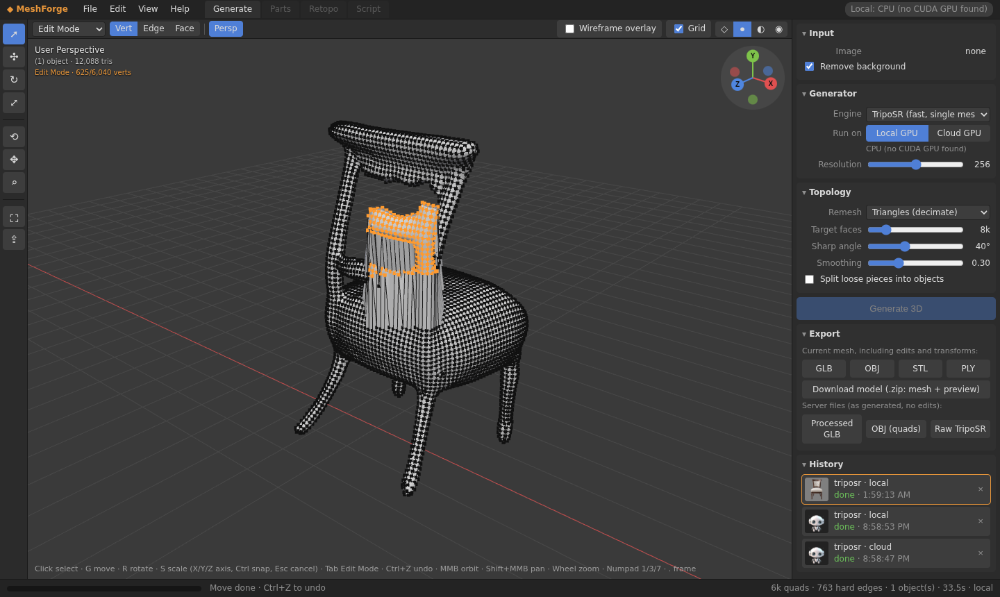

# MeshForge prototype - image → 3D, local GPU or cloud GPU

Drop an image, pick an engine and **Run on: Local GPU / Cloud GPU**, get a cleaned, low-poly (optionally quad) mesh as GLB/OBJ in a DCC-style 3D viewport.
Engine now: **TripoSR** (MIT). Planned: PartCrafter (next, fits 8 GB), OmniPart, TRELLIS.2 (cloud).



Docs: [requirements & cloud research](docs/requirements.md) · [architecture](docs/architecture.md) · [post-processing benchmark](docs/postprocessing.md) · [licensing](docs/licensing.md)

## Windows (RTX 4060) - native, recommended
**See [WINDOWS.md](WINDOWS.md).** No Ubuntu/WSL: double-click `setup_windows.bat` once, then `run_windows.bat`
(opens http://127.0.0.1:8000). `diagnose_windows.bat` writes `diagnose.txt` for troubleshooting.

<details><summary>Alternative: WSL2 (advanced)</summary>

In **PowerShell (admin)**: `wsl --install -d Ubuntu-22.04`, reboot, open Ubuntu. Keep the normal NVIDIA Windows driver; don't install a Linux driver in WSL.
```bash
sudo apt update && sudo apt install -y python3.11 python3.11-venv git build-essential
nvidia-smi                                  # must show the RTX 4060
git clone <your repo url> meshforge-proto && cd meshforge-proto   # or copy this folder in
PYTHON=python3.11 ./run.sh --setup          # first time: venv, CUDA torch, TripoSR, deps
./run.sh                                     # every other time
```
Open **http://127.0.0.1:8000** in your Windows browser. Stop with Ctrl+C.
</details>

## Linux
```bash
sudo apt install -y python3.11 python3.11-venv git build-essential
PYTHON=python3.11 ./run.sh --setup && ./run.sh
```
No NVIDIA GPU? `run.sh` installs CPU wheels; a generation then takes ~25–45 s and ~3 GB RAM.

## Cloud GPU (optional - costs money)
- `MESHFORGE_CLOUD=mock ./run.sh` (default): demo adapter, free, returns a sample 3-part mesh.
- **Modal (coded, UNTESTED):** `pip install modal && modal token new && modal deploy cloud/modal_app.py`, then `MESHFORGE_CLOUD=modal ./run.sh`. Credentials only via `modal token new` or `MODAL_TOKEN_ID`/`MODAL_TOKEN_SECRET`; nothing is stored by MeshForge.
- **Your own GPU box:** run MeshForge there, then locally `ssh -L 9000:127.0.0.1:8000 user@gpu-host` and `MESHFORGE_CLOUD=remote MESHFORGE_REMOTE_URL=http://127.0.0.1:9000 ./run.sh`. Never expose the port publicly.

## Viewport controls
MMB drag orbit · Shift+MMB pan · wheel zoom · left button selects (or orbits/pans/zooms with those shelf tools) · Numpad 1/3/7 front/right/top (Ctrl = opposite; 1/3/7 on the top row also work) · 5 persp/ortho · `.` or Home frame · Z toggle wireframe · click gizmo axes to snap. Shading: wireframe / solid / matcap / vertex colour, wireframe overlay, grid.

## Editing and exporting (new in v3)



**Tools (left shelf):** Select, Move, Rotate, Scale, then Orbit / Pan / Zoom. Click the model to select it (orange outline). With Move, Rotate or Scale active, a gizmo appears on the selection. Drag an arrow, ring or handle to transform; orbiting is paused while you drag.

**Edit Mode:** pick it in the mode dropdown (or press Tab). The mesh shows its vertices, edges and faces. If you generated with *Quads (Instant Meshes)*, the quad edges are shown; otherwise the triangle edges are. Use the Vert / Edge / Face buttons (or 1 / 2 / 3), click to select (Shift adds or toggles), and drag with the Select tool to box-select the visible elements. G / R / S then move, rotate or scale the selection. The surface updates live and its normals are recalculated. Edit Mode is designed for meshes up to about 10k faces and is capped at 200k triangles.

| Key | What it does |
|---|---|
| Left click | Select object / vertex / edge / face (Shift = add or toggle) |
| Left drag (Select tool, Edit Mode) | Box select (visible elements only) |
| G / R / S | Move / Rotate / Scale with the mouse; click or Enter to confirm |
| X / Y / Z while moving | Lock to that world axis (press again to unlock) |
| Hold Ctrl while moving | Snap (0.1 units, 15°, 0.1× scale) |
| Esc or right click | Cancel the current move |
| Tab | Object Mode ⇄ Edit Mode |
| 1 / 2 / 3 (Edit Mode) | Vertex / Edge / Face select |
| A / Alt+A | Select all (toggle) / deselect all |
| Ctrl+Z / Ctrl+Shift+Z (or Ctrl+Y) | Undo / Redo (moves and vertex edits) |
| MMB drag / Shift+MMB / wheel | Orbit / Pan / Zoom |
| Numpad 1 / 3 / 7 (Ctrl = opposite), 5, `.` | Front / Right / Top, Persp/Ortho, Frame |
| Z | Toggle wireframe shading |

Help ▸ Keyboard shortcuts shows the same table inside the app.

**Export (Export panel or File menu).** GLB, OBJ, STL and PLY are written in the browser from the *current* mesh, so they include your Edit Mode changes and the object's move, rotate and scale. **Download model (.zip)** bundles `mesh.glb`, `mesh.obj` and a `preview.png` of the viewport. The server copies are also there: the **Processed GLB**, the **OBJ (quads)** (real quads, no edits), and the **Raw TripoSR** mesh before clean-up, so you can compare. The raw mesh is kept for jobs generated with v3 or later. Click any finished item in **History** to reload it, then export it the same way.


## Layout
```
meshforge/  server.py (FastAPI) · jobs.py (queue + history) · preprocess.py · postprocess.py
            engines/ (base.py, triposr.py, registry) · runners/ (local.py, cloud.py: mock/modal/remote)
frontend/   index.html · style.css · app.js · editor.js (selection, Edit Mode, undo, export) · vendor/ (three.js 0.170 + addons, MIT)
cloud/      modal_app.py (untested)
tools_compare.py   before/after post-processing benchmark
run.sh             one-command setup/launch (Linux/WSL)
*_windows.bat      Windows setup / run / diagnose (call scripts/*.ps1)
```
API: `POST /api/jobs` (multipart: image, engine, runner, remove_bg, params JSON) · `GET /api/jobs[/{id}]` · `GET /api/jobs/{id}/mesh.glb|mesh.obj|raw.glb|input|processed.png` · `DELETE /api/jobs/{id}` · `GET /api/config`.
Params: `resolution` 128–384, `remesh` decimate|quad|none, `target_faces`, `sharp_angle` (deg), `smooth_strength` 0–1, `split_components`.
