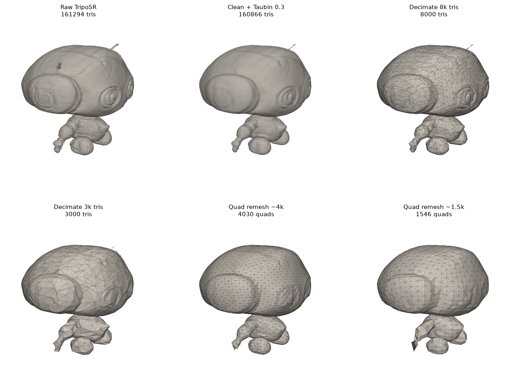

# Post-processing: before / after on the TripoSR robot

Input: `/workspace/triposr-demo/output/robot_obj/0/mesh.obj` (raw TripoSR, marching cubes res 256).
Reproduce: `python tools_compare.py /workspace/triposr-demo/output/robot_obj/0/mesh.obj docs/img/compare_robot.png`
(sharp angle 40°, smoothing 0.3; measured on the 8-core CPU box).

| Stage | Faces | Hard edges (>40°) | CPU time |
|---|---|---|---|
| Raw TripoSR | 161,294 tris | 3,698 | - |
| Clean + Taubin 0.3 | 160,866 tris | 273 | 1.3 s |
| Decimate 8k | 8,000 tris | 598 | 0.8 s |
| Decimate 3k | 3,000 tris | 395 | 0.8 s |
| Quad remesh ~4k | 4,030 quads | 308 | 1.1 s |
| Quad remesh ~1.5k | 1,546 quads | 263 | 1.0 s |

(Matplotlib flat-shaded render with edges; the app viewer additionally uses the split normals.)

**What improved**
- 20–100x fewer polygons with the silhouette kept; quad mode gives a clean, evenly spaced, almost all-quad mesh (OBJ has true 4-sided faces) - a usable base for sculpting/subdivision in Blender or ZBrush.
- Taubin removes the marching-cube "3D-printed" stair-stepping (raw 3,698 noisy "hard" edges → ~270 after smoothing) without shrinking the volume.
- Hard edges get split normals, so surfaces render smooth while creases stay crisp.
- Floating fragments removed, holes filled, normals consistent.

**What it cannot fix (still needs manual retopology / better engines)**
- Detail that TripoSR never produced (back/side guesses, soft eyes, thin antenna) cannot be recovered; smoothing and decimation lose even more of it at very low counts (3k tris looks faceted).
- Edge flow is field-aligned, not animation-aware: no loops around eyes/mouth/joints, no deformation-friendly topology, a few triangles/pentagons at singularities.
- "Sharp" edges are detected, not created: the raw volume has rounded corners, so hard-surface bevels stay soft. Real sharpness needs a higher-resolution engine.
- Vertex colours only; no UVs or textures yet.

**How this connects to later stages**
- **TRELLIS.2** (cloud) outputs much sharper, higher-resolution geometry; the same pipeline then works on a better input, and the sharp-angle split becomes far more meaningful.
- **PartCrafter / OmniPart** return separate parts; the module processes each part with its own share of the face budget, so small parts (buckle, sword) keep detail and each part is a separate object.
- Next to try: (1) PartCrafter locally; (2) per-part quad remesh with symmetry (L/R) and edge-length by curvature; (3) UV unwrap (xatlas, MIT) + bake vertex colours to a texture; (4) a "game-ready" preset (LOD0/LOD1/LOD2 targets).
