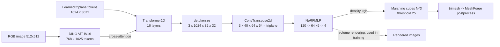

# TripoSR code map for MeshForge

*A guided reading of TripoSR at commit `107cefd` with the `stabilityai/TripoSR` weights. Every line number, shape and parameter count below was checked against the code or measured with forward hooks on 26 Oct 2026.*

---

## 0. What is and isn't in the repo

**There is no training code.** The public repo is for running the model only. It has no dataset loader, no loss functions, no optimiser, no training loop and no training config. The only training-related pieces are:

- `TriplaneNeRFRenderer.train()` (`tsr/models/nerf_renderer.py:174`), which turns on randomised ray sampling.
- A `gradient_checkpointing` flag in `Transformer1D` (`transformer_1d.py`, around line 192) and in the DINO tokenizer.

The renderer is differentiable, so you can backpropagate through `model.render(...)` or `query_triplane(...)` if you remove the `torch.no_grad()` wrappers in `system.py` (lines 154, 175 and 193). You have to write the training loop yourself, and that loop is the main thing you'll build (see §3).

The paper (arXiv 2403.02151) describes the original training: Objaverse renders, rendering loss plus LPIPS plus mask loss, and a large GPU cluster. That recipe is described but not released.

Licence: the code and weights are MIT. DINO (`facebook/dino-vitb16`) is Apache-2.0.

---

## 1. The pipeline in plain words

1. **Image to tokens.** The photo is resized to 512×512 and fed to DINO, a pretrained Vision Transformer. DINO cuts it into 16×16-pixel patches (32×32 = 1024 patches, plus 1 summary token) and describes each one with 768 numbers.
2. **Learned triplane tokens.** The model owns a fixed, learned set of 3 planes × 32×32 cells × 1024 channels, which gives 3072 tokens. You can think of it as a blank 3D canvas.
3. **Transformer backbone.** There are 16 layers. In each one, the canvas tokens attend to each other (self-attention) and look at the image tokens (cross-attention). After this, the canvas describes *this* object.
4. **Upsample.** One transposed convolution turns each plane from 32×32×1024 into 64×64×40. The result is the **triplane**, also called the `scene_code`.
5. **Decoder (NeRF MLP).** For any 3D point (x, y, z), the model samples the XY, XZ and YZ planes, concatenates the samples (3×40 = 120 numbers) and passes them through a small MLP. The MLP outputs a **density** (how solid the point is) and an **RGB colour**.
6. **Marching cubes.** The decoder is queried on an N³ grid (default 256³ ≈ 16.7 M points). The surface is taken where density = 25 (`threshold`), which produces the triangle mesh.
7. **MeshForge post-processing** (your code): clean, smooth, decimate, quad-remesh and auto-smooth normals.



**Measured parameter counts** (419.3 M in total):

| Part | Parameters |
|---|---|
| DINO image tokenizer | 86.4 M |
| Triplane tokens | 3.1 M |
| Transformer backbone | 329.5 M |
| Upsampler | 0.16 M |
| **Decoder MLP** | **0.041 M (41 k)** |

Almost all of the "intelligence" is in the backbone, and the decoder is tiny. That matters for what you can train on 8 GB.

---

## 2. File-by-file reading order

The paths are relative to `TripoSR/`. The shapes come from forward hooks on a real CPU run, with batch size B = 1.

### Step 1: `run.py` (the entry point)

Read the whole file top to bottom.

- `--mc-resolution` (line 67) sets the marching-cubes grid.
- Line 127 calls `model.renderer.set_chunk_size(...)`.
- Line 173 calls `model.extract_mesh(scene_codes, not args.bake_texture, resolution=...)`.
- Lines 177–186 handle the optional texture bake.

**Exercise:** run it once with `--mc-resolution 128` and once with `384`, and compare face counts and timings. The `Timer` class (line 17) prints them.

### Step 2: `tsr/system.py` (the whole model on one page; read it closely)

| Lines | What |
|---|---|
| 26–49 | `class TSR` and its `Config`. Every sub-module is chosen by a *class-path string* in `config.yaml`. |
| 52–71 | `from_pretrained`: downloads `config.yaml` and `model.ckpt` from Hugging Face, then `load_state_dict`. |
| 73–85 | `configure`: builds image_tokenizer, tokenizer, backbone, post_processor, decoder and renderer through `find_class` (`utils.py:24`). |
| 87–120 | **`forward`**: image → `scene_codes`. This is the core. |
| 122–161 | `render`: volume-renders N views around the object. This is how training supervision would work. |
| 163–169 | `set_marching_cubes_resolution` |
| 171–205 | **`extract_mesh`**: queries density on the grid, runs marching cubes at `-(density - threshold)` (line 185) and optionally queries vertex colour (lines 192–198). |

Shapes inside `forward`:

```
rgb_cond            (B, 1, 512, 512, 3)       # line 99, after ImagePreprocessor
input_image_tokens  (B, 1, 768, 1025) -> rearranged to (B, 1025, 768)   # lines 104-110
tokens (init)       (B, 1024, 3072)           # line 112, 3072 = 3 planes * 32 * 32
tokens (backbone)   (B, 1024, 3072)           # lines 114-117
detokenize          (B, 3, 1024, 32, 32)
scene_codes         (B, 3, 40, 64, 64)        # line 119
```

Here is `config.yaml`, which lives in the HF cache at `~/.cache/huggingface/hub/models--stabilityai--TripoSR/snapshots/*/config.yaml`:

```yaml
cond_image_size: 512
tokenizer:       { plane_size: 32, num_channels: 1024 }
backbone:        { in_channels: 1024, num_attention_heads: 16, attention_head_dim: 64,
                   num_layers: 16, cross_attention_dim: 768 }
post_processor:  { in_channels: 1024, out_channels: 40 }
decoder:         { in_channels: 120, n_neurons: 64, n_hidden_layers: 9, activation: silu }
renderer:        { radius: 0.87, feature_reduction: concat, density_activation: exp,
                   density_bias: -1.0, num_samples_per_ray: 128 }
```

### Step 3: `tsr/utils.py` (helpers)

- `BaseModule` (lines 46–62) is the pattern every module uses: `Config` dataclass → `configure()`.
- `ImagePreprocessor` is at line 64.
- `scale_tensor` (line 224) remaps coordinate ranges, for example `[0,1]` to `[-0.87, 0.87]`.
- `get_activation` (line 236): density uses plain `exp` (line 242).
- `get_ray_directions`, `get_rays` and `get_spherical_cameras` (lines 257, 299, 341) build the camera rays used by `render`. Your dataset cameras must match this convention (§4).
- `remove_background` and `resize_foreground` (lines 402, 417) handle input prep.

### Step 4: `tsr/models/tokenizers/image.py` (DINO)

- `DINOSingleImageTokenizer.configure` (lines 20–42) builds `ViTModel` from the DINO *config only*. The DINO weights come from TripoSR's own checkpoint, not from `facebook/dino-vitb16`'s weights.
- `forward` (lines 44–63) normalises with ImageNet mean/std and uses `last_hidden_state` → `(B, N, 768, 1025)`. The pooled output is computed and then ignored.

### Step 5: `tsr/models/tokenizers/triplane.py` (the blank canvas)

- `Triplane1DTokenizer.configure` (lines 19–27) holds one `nn.Parameter` of shape `(3, 1024, 32, 32)`.
- `forward` (lines 29–33) flattens it to `(B, 1024, 3072)`.
- `detokenize` (lines 35–45) reshapes it back. Line 41 has the einops pattern `B Ct (Np Hp Wp) -> B Np Ct Hp Wp`. Learn einops here, because the whole repo uses it.

### Step 6: `tsr/models/transformer/transformer_1d.py` → `basic_transformer_block.py` → `attention.py`

- `Transformer1D` (line 50) and its `forward` (line 122). The flow is: GroupNorm (~183) → `proj_in` (~188) → loop over 16 `BasicTransformerBlock`s (~191) → `proj_out` (~210) → residual add.
- Each block does self-attention, then cross-attention to the image tokens, then a feed-forward layer.
- `attention.py` (653 lines) is adapted from HuggingFace `diffusers`. Skim it; you don't need every line.
- This is where LoRA adapters would go: the `to_q`, `to_k`, `to_v` and `to_out` linear layers inside `Attention`.

### Step 7: `tsr/models/network_utils.py` (upsampler and decoder)

- `TriplaneUpsampleNetwork` (lines 11–32) is one `ConvTranspose2d(1024→40, k=2, s=2)`, so 32×32 becomes **64×64**.
- `NeRFMLP` (lines 35–124) is Linear 120→64, SiLU, then 8 × (64→64, SiLU), then 64→**4**. The output dict at line 122 is `density = [...,0:1]` and `features = [...,1:4]`.

### Step 8: `tsr/models/nerf_renderer.py` (triplane sampling and volume rendering)

- `query_triplane` (lines 41–91) is **the most important function for quality work**.
  - It scales xyz into [-1, 1] (line 52) and builds 2D indices for the XY, XZ and YZ planes (lines 57–60).
  - It samples them with `F.grid_sample(..., mode="bilinear")` (lines 61–66) and concatenates to 120 features (line 68).
  - It runs the decoder (line 74), then applies `density_act = exp(density - 1)` and `color = sigmoid(features)` (lines 82–87).
- `_forward` (lines 93–152) is classic NeRF volume rendering: 128 samples per ray, alpha compositing and a white background.
- `train()` and `eval()` are at lines 174 and 178.

### Step 9: `tsr/models/isosurface.py` (marching cubes)

- `MarchingCubeHelper.grid_vertices` (lines 24–38) creates the N³ grid on the CPU.
- `forward` (lines 40–52) calls `torchmcubes.marching_cubes(level, 0.0)`, swaps the axes to `[2,1,0]` (line 50) and normalises by `resolution-1`.
- In your Windows and box installs, `torchmcubes` is our shim (`torchmcubes_shim.py`, wrapping scikit-image marching cubes) rather than the compiled CUDA package.

### Step 10: `tsr/bake_texture.py` (optional)

- `make_atlas` (line 9) builds a UV atlas with xatlas.
- `rasterize_position_atlas` (line 25) rasterises it with moderngl.
- `positions_to_colors` (line 137) queries `color` at each texel.
- `bake_texture` is at line 151.

The output is a UV-mapped texture instead of vertex colours. MeshForge doesn't use this yet.

### Step 11: your wrapper in `/workspace/meshforge-proto/meshforge/`

- `engines/triposr.py`:
  - `TripoSREngine.load` (line 20) sets the chunk size to 8192 on CUDA or 2048 on CPU (line 28).
  - `generate` (line 31) runs forward, then `extract_mesh(codes, True, resolution=res)` (lines 41–42). The default resolution is 256.
- `postprocess.py`:
  - `clean` (line 19) and `smooth` (35, Taubin)
  - `decimate` (52, fast-simplification)
  - `quad_remesh` (65, instant-meshes)
  - `sharp_edges` and `auto_smooth` (82, 86)
  - `process_mesh` (96)
  - `export` (149)

### Debugging snippet (verified to run)

```python
import torch; from PIL import Image
from tsr.system import TSR
m = TSR.from_pretrained("stabilityai/TripoSR", "config.yaml", "model.ckpt").eval()
hook = lambda name: (lambda mod, i, o: print(name, tuple(o.shape)))
for n in ["image_tokenizer", "backbone", "post_processor"]:
    getattr(m, n).register_forward_hook(hook(n))
with torch.no_grad():
    codes = m([Image.open("in.png")], "cuda")   # -> (1, 3, 40, 64, 64)
# image_tokenizer (1, 1, 768, 1025) | backbone (1, 1024, 3072) | post_processor (1, 3, 40, 64, 64)
```

**Visualising the triplanes:** for each of the 3 planes, take `codes[0, p]`, which has shape (40, 64, 64). Run PCA from 40 channels down to 3 and save the result as an RGB image. You'll see the object's silhouette from the top, front and side.

---

## 3. Where the quality limits come from

| Limit | Where in the code | Effect |
|---|---|---|
| **Triplane is only 64×64 per plane** | `post_processor.out_channels: 40`, `plane_size: 32` ×2 upsample | Detail finer than about 1/64 of the bounding box (≈2.7 cm on a 1.74 m-wide box) can't be represented. Raising the marching-cubes resolution beyond this mostly adds triangles, not detail. |
| **Bilinear plane sampling plus a 41 k-param MLP** | `query_triplane` lines 61–74 | The result is smooth and blobby, and sharp creases get rounded. |
| **Density field, not an SDF** | `density_act = exp(x - 1)`, iso at threshold 25 (`system.py:171,185`) | The surface location depends on an arbitrary threshold, so walls get thick or lumpy and the topology is noisy. |
| **Marching cubes** | `isosurface.py` | Triangles are uniform and grid-aligned, with no edge flow and no sharp features (MC cuts corners). The default 256³ grid gives hundreds of thousands of faces. |
| **Single view, trained on Objaverse** | `cond_image_size: 512`, one view | The back of the object is guessed, and the model is biased towards Objaverse-style assets. |
| **No PBR texture** | `color` = sigmoid RGB | The output is vertex colour with baked lighting from the input. |

### Experiments, ranked by effort

**E1. Resolution and threshold sweep.** Effort: hours. Hardware: your 4060.
Try `resolution` ∈ {192, 256, 320, 384} × `threshold` ∈ {10, 25, 40}. Measure faces, time, and Chamfer distance to a ground-truth mesh if you have one. You'll find that detail plateaus at around 256–320, because the triplane is the limit.

**E2. Better surface extraction without training.** Effort: 1–3 days. Hardware: 4060.
- Replace marching cubes with **Dual Contouring** or **Neural Dual Contouring**-style extraction, which keeps sharp corners.
- Alternatively, snap MC vertices to the iso-surface along the density gradient. You get the gradient through `torch.autograd` on `query_triplane`.
- Feed the result into the existing remesh pipeline.

This is a pure algorithm change in `isosurface.py` and `extract_mesh`.

**E3. Normal-aware post-processing.** Effort: 2–4 days. Hardware: 4060.
- Compute analytic normals from the density gradient at each vertex.
- Use them to guide Taubin smoothing (keep creases) and to give quad-remesh orientation hints.
- This improves "sharp yet smooth" without any training.

**E4. Finetune only the decoder MLP (41 k params) plus the upsampler (164 k) on your data.** Effort: 1–2 weeks, mostly writing the training loop. Hardware: **fits 8 GB**.
- Freeze DINO and the backbone, then precompute and cache `scene_codes` for every training image. Each one is only 3×40×64×64 floats, about 2 MB. The backbone never needs to run during training.
- Losses:
  - occupancy or SDF supervision on points sampled near your GT meshes
  - optionally, a rendering loss through `renderer._forward` on a few hundred rays per step
- This teaches the decoder your style of surface, but it can't add detail that isn't in the triplane.

**E5. SDF-style output head.** Effort: 2–3 weeks. Hardware: 4060 for the decoder-only version.
- Change `NeRFMLP`'s density output into a signed distance and train it with SDF L1 and an eikonal loss. Use `density = f(sdf)`, for example VolSDF or NeuS, if you also want rendering.
- Extract at level 0 instead of the magic threshold of 25.
- Expect much cleaner, thinner, watertight surfaces. This is the single biggest *conceptual* upgrade for topology.

**E6. LoRA on the transformer attention (`to_q`, `to_k`, `to_v`, `to_out`).** Effort: 2–4 weeks. Hardware: **borderline on 8 GB**.
- Freeze the 330 M base and train LoRA at rank 8–16.
- You need fp16/bf16, gradient checkpointing (already plumbed in), batch size 1 and a small render-ray budget.
- Doable on the 4060 but slow. A rented 24 GB GPU (RTX 4090 or L4/A10) at roughly $0.4–0.8/h is far more comfortable.
- This is what actually adapts the model to your art style and the kinds of objects you make.

**E7. Higher-resolution triplane (64→128 or 256, with a new or extra upsampler).** Effort: 3–6 weeks. Hardware: **rented GPU**.
- Add a second upsample stage. Train it plus the decoder, and LoRA the backbone.
- Memory for rendering supervision rises steeply. Plan on 24–48 GB (A6000 or A100) for tens of GPU-hours.

**E8. Part-label conditioning (your colour-coded data).** Effort: 1–3 months. Hardware: **rented GPU**.
- Add a *part-ID* output to the decoder: 4 → 4 + K logits, trained with cross-entropy against per-point part labels. Then extract one mesh per part, using argmax labels on the grid followed by per-label marching cubes.
- An optional second step feeds the colour-coded mask as an extra input channel or token set to the backbone.
- Before building your own, study OmniPart and PartCrafter (both MIT), which already do this.

Rule of thumb for an 8 GB card: inference, E1–E5 and decoder-only training are fine. Anything that backpropagates through the 330 M backbone needs LoRA plus checkpointing, or rented 24 GB+.

---

## 4. Dataset plan

**Format per asset** (one folder each):

```
dataset/
  asset_000123/
    mesh.glb                # ground-truth mesh, normalised to fit a sphere r <= 0.5 (TripoSR uses radius 0.87 box)
    meta.json               # licence, author, category, part list, poly count, source
    renders/
      rgba_000.png ... rgba_023.png    # 512x512, transparent background
      normal_000.png ...               # optional: world-space normals
      depth_000.exr ...                # optional
      parts_000.png ...                # optional: flat-colour part-ID pass (no AA, no lighting)
    cameras.json            # per view: 4x4 cam-to-world, fov (deg), elevation, azimuth, distance
    points_sdf.npz          # N x 3 points + signed distance (or occupancy) sampled near/inside/outside
    points_parts.npz        # same points + int part id (for E8)
```

**How to make it in Blender (scriptable with `bpy`, headless with `blender -b -P render.py`):**

1. Import the asset, centre it and scale it into the unit sphere.
2. Place 24 cameras on a sphere: 4 elevations (−10°, 10°, 30°, 50°) × 6 azimuths, distance about 1.9, FOV 40°. These match `system.py` `render` defaults (`camera_distance=1.9, fovy_deg=40`).
3. Render RGBA with Eevee or Cycles under neutral lighting.
4. Add a second pass with emission-only materials for the **part-ID** colours. Turn off colour management (use "Standard", not Filmic or AgX) so the colours stay exact.
5. Export `cameras.json` from `camera.matrix_world`.
6. Compute SDF and occupancy points in Python with `trimesh` (`mesh.contains`, `proximity.signed_distance`) outside Blender. The mesh must be watertight. If it isn't, use a winding-number method.

**Watch out for:** Blender is Z-up, and TripoSR's camera code is OpenGL-style. Write one tiny test that renders your GT mesh through `get_spherical_cameras` and overlays it on your Blender render before you train anything.

**Naming and labelling convention for parts:**

- Asset IDs: `<category>_<6-digit id>`, for example `char_000042` or `prop_000311`.
- Keep one fixed **global part table** (`parts.json`) and never reuse an ID:

| id | name | RGB |
|---|---|---|
| 0 | background | (0, 0, 0) |
| 1 | head | (255, 0, 0) |
| 2 | torso | (0, 255, 0) |
| 3 | arm_L | (0, 0, 255) |
| 4 | arm_R | (255, 255, 0) |
| … | … | … |

- Name the Blender objects `part__<name>` so the script can assign colours automatically.
- Use left/right from the *character's* point of view.
- Keep colours saturated and far apart so they survive JPEG and resizing, but store PNG only.

**How many assets you need (realistic estimates, not guarantees):**

| Goal | Assets |
|---|---|
| Decoder-only finetune or SDF head (E4/E5) | 200–1,000, ×24 views |
| LoRA style adaptation (E6) | 1,000–5,000 |
| Part head (E8) | 2,000+ labelled, plus augmentation |
| Training from scratch | Hundreds of thousands. TripoSR used a curated Objaverse subset. **Not realistic solo; always start from the pretrained weights.** |

You can bootstrap by mixing your own assets with permissively licensed public sets. Use Objaverse items marked CC-BY or CC0 and keep their attribution in `meta.json`. Leave out CC-NC items if you want commercial freedom.

**Licensing your own data:** assets you model yourself are your copyright. Keep the raw dataset private. Decide early whether you'll ever release it, for example as CC-BY-4.0 for credibility in a visa or funding case, or keep it as a proprietary moat. Record the source and licence of every asset in `meta.json` from day one. Don't include ripped game assets or marketplace models whose EULA forbids AI training, because that one shortcut can taint the whole dataset.

---

## 5. Six-week learning path (about 6–10 h/week)

**Week 1: PyTorch and einops basics.**
- Goal: be comfortable with tensors, `nn.Module`, autograd, `.to("cuda")` and `torch.no_grad`.
- Exercises:
  - Build and train a tiny MLP that fits a 2D image, i.e. coordinates to RGB.
  - Rewrite three of the repo's `rearrange` calls (for example `triplane.py:39-45`) with `view` and `permute`, and assert that the results are equal.

**Week 2: run and instrument TripoSR.**
- Goal: own the forward pass.
- Exercises:
  - Run the hook snippet from §2.
  - Time each stage with `torch.cuda.synchronize()` and record peak VRAM with `torch.cuda.max_memory_allocated()` on the 4060.
  - Save the PCA images of the triplanes.

**Week 3: fields and surfaces.**
- Goal: understand density and marching cubes.
- Exercises:
  - Slice `density_act` on a 256² plane through the object and plot it as a heat map.
  - Run experiment E1.
  - Write marching cubes yourself for a sphere SDF in NumPy, at small scale, to see why corners get cut.

**Week 4: rendering and cameras.**
- Goal: make `render()` match Blender.
- Exercises:
  - Write the Blender render script (§4) for 10 of your assets.
  - Render the same views with `model.render` and overlay them.
  - Fix any axis or FOV mismatch until the silhouettes line up.

**Week 5: your first training loop (E4).**
- Goal: finetune the decoder on 8 GB.
- Exercises:
  - Cache `scene_codes` for your 10–50 assets.
  - Sample SDF or occupancy points and train the decoder with an occupancy BCE loss for an hour.
  - Compare Chamfer distance and visual results before and after. Use a held-out asset.

**Week 6: one real algorithm change.**
- Goal: pick E2 (dual contouring) or E5 (SDF head), implement it behind a flag in MeshForge's engine, and measure it.
- Exercises:
  - Add the new engine variant to `meshforge/engines/` so the UI can A/B it against stock TripoSR.
  - Write a one-page result note with images, faces and Chamfer distance. That note becomes your first portfolio and visa evidence piece.

After week 6: E6 (LoRA) on a rented GPU, then E8 (part-based) once you have a few hundred colour-coded assets.

---

## Key references

- TripoSR code: https://github.com/VAST-AI-Research/TripoSR. Paper: https://arxiv.org/abs/2403.02151
- LRM (the architecture TripoSR follows): https://arxiv.org/abs/2311.04400
- NeuS / VolSDF (SDF + rendering): https://arxiv.org/abs/2106.10689, https://arxiv.org/abs/2106.12052
- LoRA: https://arxiv.org/abs/2106.09685
- PartCrafter / OmniPart (MIT, part-based): https://github.com/wgsxm/PartCrafter, https://github.com/omnipart/OmniPart
